# AWS Log Ingestion Architectures for CrowdStrike Falcon LogScale

This domain showcases battle-tested architectural blueprints for ingesting enterprise telemetry from Amazon Web Services (AWS) and third-party SaaS platforms into CrowdStrike Falcon LogScale (Humio).

---

## Ingestion Topologies

```mermaid
flowchart TD
    subgraph S3_SQS["1. S3-to-SQS Pull Ingestion (High Volume)"]
        AWSLogs[VPC Flow / ALB / CloudTrail] --> S3[S3 Bucket]
        S3 --> SQS[SQS Queue]
        SQS -->|Pull via IAM Role| LS1[LogScale Cluster]
    end

    subgraph Serverless["2. Serverless API Pollers (SaaS & Third-Party)"]
        Cron[EventBridge Scheduler] --> Lmb[Lambda Workers]
        Lmb -->|REST API| SaaS[Okta / GitHub / Snyk / GCP]
        Lmb -->|Push NDJSON| LS2[LogScale Ingest API]
    end

    subgraph OTel["3. Real-Time OTLP Telemetry (AI & Microservices)"]
        Agents[AI Coding Agents / LLMs] --> APIGW[API Gateway]
        APIGW --> OTelLmb[OTel Unwrapper Lambda]
        OTelLmb -->|Structured Ingest| LS3[LogScale Ingest API]
    end
```

---

## Ingestion Pattern Comparison

| Metric / Attribute | S3-to-SQS Pull Feed | Serverless API Poller | OpenTelemetry Collector |
| :--- | :--- | :--- | :--- |
| **Typical Log Sources** | VPC Flow, ALB Access, CloudTrail | GitHub Audit, Okta System Log, Snyk | Claude Code, LangChain, Microservices |
| **Data Movement** | Pull (LogScale initiates) | Push (Lambda pushes) | Push (Client pushes via API Gateway) |
| **Throughput Capability** | Terabytes / day (unlimited) | Millions of API records / day | High-frequency streaming spans / logs |
| **Backpressure / Buffering**| 14-day native SQS queue retention | SQS Dead Letter Queue (DLQ) retry | In-memory Lambda retry / API GW throttles |
| **Authentication** | Cross-Account STS `AssumeRole` | API Tokens in AWS Secrets Manager | Bearer Token in API Gateway headers |
| **Directory** | [`s3-sqs-pull-feed/`](./s3-sqs-pull-feed/) | [`serverless-api-poller/`](./serverless-api-poller/) | [`telemetry-otel-collector/`](./telemetry-otel-collector/) |

---

## Architectural Deep Dives

1. **[S3-SQS Pull Feed Architecture](./s3-sqs-pull-feed/)**: Complete IaC (Pulumi and Terraform) for provisioning S3 buckets, SQS queues, bucket notification policies, and cross-account IAM roles trusted by CrowdStrike LogScale.
2. **[Serverless API Poller Engine](./serverless-api-poller/)**: Production Python serverless functions polling SaaS APIs with ETag caching, RFC 5988 cursor pagination, 429 rate limit backoff, and Secrets Manager integration.
3. **[OpenTelemetry AI Telemetry Collector](./telemetry-otel-collector/)**: Serverless collector translating OTLP/HTTP traces and logs from GenAI coding agents into LogScale structured events.
