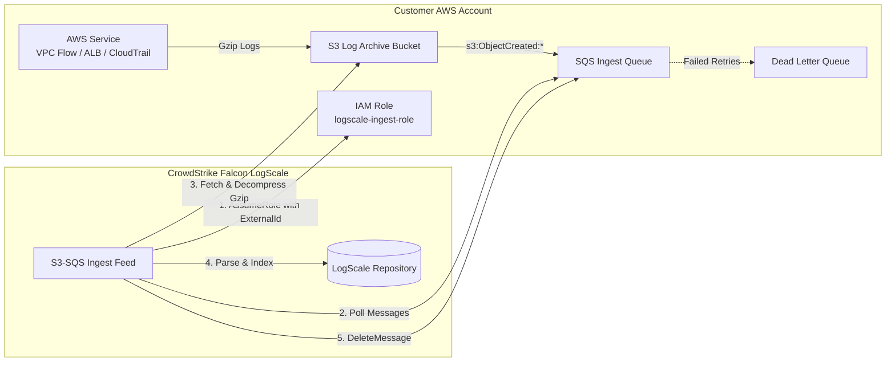

# AWS S3-to-SQS Pull Ingestion for CrowdStrike LogScale

This module provides production-grade Infrastructure as Code (IaC) blueprints for ingesting high-volume AWS log streams (such as **VPC Flow Logs**, **Application Load Balancer (ALB) Access Logs**, and **AWS CloudTrail**) into CrowdStrike Falcon LogScale using the pull-based S3-SQS Ingest Feed architecture.

---

## Architecture Overview



### Why Pull-Based S3-SQS Ingestion?

1. **Massive Throughput & Zero Throttling**: High-volume VPC Flow logs or web tier ALB logs can generate millions of events per minute. Directly pushing these via Lambda or API Gateway risks hitting account concurrency limits, API throttling, and expensive invocation costs.
2. **Durability & Lossless Backpressure**: Amazon SQS buffers log availability messages for up to 14 days. If the LogScale cluster experiences network blips or ingestion maintenance, zero logs are dropped; LogScale resumes reading from the queue once connectivity is restored.
3. **Bandwidth Optimization**: AWS services compress raw logs (`.tar.gz`, `.gz`) before writing to S3. LogScale fetches compressed objects directly, dramatically reducing cross-cloud data transfer costs.
4. **Least Privilege Security**: The cross-account IAM role only grants `s3:GetObject` on the specific bucket and `sqs:ReceiveMessage`/`sqs:DeleteMessage` on the queue. It requires a mandatory `sts:ExternalId` check to prevent confused-deputy attacks.

---

## Directory Contents

| Component | Path | Description |
| :--- | :--- | :--- |
| **Pulumi Program** | [`pulumi/`](./pulumi/) | Pulumi Python program defining S3, SQS, SQS Policy, Bucket Notifications, and IAM roles. |
| **Terraform Blueprint** | [`terraform/`](./terraform/) | Terraform root module combining AWS resources with the `logscale_aws_s3_sqs_ingest_feed` resource. |
| **IAM Policy References** | [`iam/`](./iam/) | Standalone JSON trust policy and permissions policy documents. |

---

## Ingest Feed Configuration Parameters

When creating an Ingest Feed in LogScale (either via Terraform or the UI under **Settings > Ingest > Ingest Feeds**), the following settings must be specified:

| Parameter | Recommended Value | Rationale |
| :--- | :--- | :--- |
| **Feed Type** | `Amazon S3 via SQS` | Pull-based managed ingestion engine. |
| **Preprocessing Kind** | `SplitNewline` | VPC Flow Logs and ALB access logs are newline-delimited text files. |
| **Compression** | `Auto` | Automatically detects and decompresses `.gz` and plaintext archives. |
| **Authentication Kind** | `IamRole` | Assumes the cross-account role in your AWS account using STS. |
| **Role ARN** | `arn:aws:iam::<ACCOUNT_ID>:role/<ROLE_NAME>` | The IAM role configured with LogScale's trust policy. |
| **Queue URL** | `https://sqs.<REGION>.amazonaws.com/<ACCOUNT_ID>/<QUEUE_NAME>` | Target queue receiving S3 object creation notifications. |
| **Parser** | `aws-vpc-flow` or `aws-alb-access` | Associated parser to structure the extracted log lines. |

---

## Security & IAM Deep Dive

### 1. Cross-Account Trust Policy (`trust_policy.json`)

LogScale uses its dedicated ingest AWS account (`426876924399`) to assume your role. You must supply a unique `sts:ExternalId` provided by LogScale during feed creation:

```json
{
  "Version": "2012-10-17",
  "Statement": [
    {
      "Sid": "AllowLogscaleAssumeRole",
      "Effect": "Allow",
      "Principal": {
        "AWS": "arn:aws:iam::426876924399:role/cs_logscale_granter_role"
      },
      "Action": "sts:AssumeRole",
      "Condition": {
        "StringEquals": {
          "sts:ExternalId": "<LOGSCALE_GENERATED_EXTERNAL_ID>"
        }
      }
    }
  ]
}
```

### 2. SQS Queue Access Policy

Amazon S3 requires explicit permission to publish notification messages to the target SQS queue. The `Condition` block restricts publishing strictly to your log bucket ARN to prevent cross-account event injection.

---

## Deployment Quickstart

### Option A: Using Terraform

1. Navigate to the Terraform directory:
   ```bash
   cd 01-aws-ingestion/s3-sqs-pull-feed/terraform/
   ```
2. Initialize and configure variables:
   ```bash
   cp terraform.tfvars.example terraform.tfvars
   # Fill in logscale_external_id and environment
   terraform init
   terraform plan
   ```

### Option B: Using Pulumi

1. Navigate to the Pulumi directory:
   ```bash
   cd 01-aws-ingestion/s3-sqs-pull-feed/pulumi/
   ```
2. Set configuration and deploy:
   ```bash
   pulumi stack init prod
   pulumi config set aws:region us-east-1
   pulumi config set --secret logscale_external_id "your-external-id"
   pulumi preview
   ```
