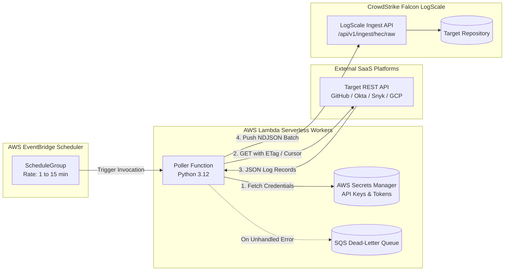

# Serverless EventBridge & Lambda API Log Poller Architecture

This module demonstrates how to ingest telemetry from SaaS platforms and third-party APIs (such as **GitHub Enterprise**, **Okta**, **Snyk**, and **GCP Cloud Audit**) that do not natively stream logs to AWS S3.

---

## Architectural Workflow



---

## Core Engineering Patterns

### 1. Zero-Burn ETag Caching (GitHub Poller)
Public API rate limits are easily exhausted by aggressive polling (e.g. GitHub enforces a strict 5,000 req/hr rate limit per organization). The GitHub poller caches HTTP `ETag` values in `/tmp/github-etag-cache.json`. When no new audit events have occurred, GitHub responds with `304 Not Modified`, which **does not count** against your API rate quota.

### 2. RFC 5988 Cursor Pagination & 429 Backoff (Okta Poller)
High-volume enterprise Okta tenants generate thousands of authentication events per minute. The Okta poller follows RFC 5988 `Link` headers with `rel="next"`, dynamically reading `X-Rate-Limit-Reset` and executing exponential backoff if HTTP 429 is encountered.

### 3. Declarative Infrastructure Matrix
Instead of manually copy-pasting AWS resources for every log source, [`infrastructure/__main__.py`](./infrastructure/__main__.py) drives the creation of all Lambdas, IAM roles, EventBridge schedules, and DLQs from a single declarative Python dictionary:

```python
api_ingest_products = {
    "okta": {"schedule_interval_minutes": 2, "timeout_seconds": 300, "handler_path": "../lambdas/okta"},
    "github": {"schedule_interval_minutes": 5, "timeout_seconds": 300, "handler_path": "../lambdas/github"},
    "snyk": {"schedule_interval_minutes": 15, "timeout_seconds": 300, "handler_path": "../lambdas/snyk"},
}
```

---

## Directory Organization

```
serverless-api-poller/
├── infrastructure/     # Pulumi program automating all Lambda functions & schedules
└── lambdas/            # Production poller source code
    ├── github/         # GitHub Audit Log poller with ETag caching
    ├── okta/           # Okta System Log poller with cursor pagination
    ├── snyk/           # Snyk vulnerability & audit log poller
    └── gcp-audit/      # GCP Cloud Audit forwarder
```

---

## Operational Runbook: Adding a New Poller

1. Create a new directory under `lambdas/<product_name>/` containing `lambda_function.py` and `requirements.txt`.
2. Ensure the handler fetches credentials from `logscale/<product_name>-credentials` in AWS Secrets Manager.
3. Add the product specification to the `api_ingest_products` dictionary in [`infrastructure/__main__.py`](./infrastructure/__main__.py).
4. Run `pulumi up` to automatically provision the Lambda, IAM roles, EventBridge schedules, and SQS DLQ.
