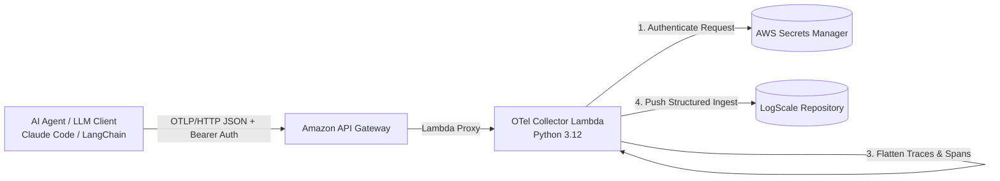

# OpenTelemetry (OTLP) AI Telemetry Collector for LogScale

This module provides a serverless OpenTelemetry collector endpoint running on AWS API Gateway and Lambda. It ingests OTLP/HTTP JSON traces, metrics, and logs emitted by AI coding assistants (such as Claude Code, Cursor, Copilot), LLM orchestration frameworks (LangChain, LlamaIndex), and microservices, forwarding normalized telemetry directly into CrowdStrike Falcon LogScale.

---

## Architectural Flow



---

## Client Environment Configuration

To configure AI tools (like Claude Code) to ship telemetry into this collector:

```bash
# Enable telemetry emission
export CLAUDE_CODE_ENABLE_TELEMETRY=1
export CLAUDE_CODE_ENHANCED_TELEMETRY_BETA=1

# Point to API Gateway endpoint
export OTEL_EXPORTER_OTLP_PROTOCOL=http/json
export OTEL_EXPORTER_OTLP_ENDPOINT="https://<api-gateway-id>.execute-api.us-east-1.amazonaws.com"
export OTEL_EXPORTER_OTLP_HEADERS="Authorization=Bearer <your-custom-otlp-token>"
```

---

## Secrets Manager Schema

Stored under secret `logscale/claude-otel-credentials`:

```json
{
  "logscale_url": "https://cloud.humio.com",
  "logscale_token": "xxxxxxxx-xxxx-xxxx-xxxx-xxxxxxxxxxxx",
  "otlp_auth_token": "randomly-generated-bearer-token"
}
```
