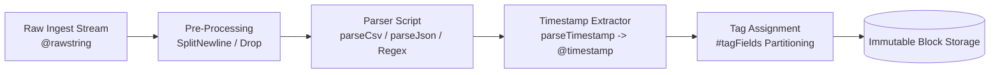

# CrowdStrike Falcon LogScale Parsers & Transforms

Production parser definitions (`v0.3.0` schema) and data transformation patterns for ingesting diverse log shapes into LogScale.

---

## LogScale Parser Architecture

In LogScale, parsers execute at **ingest time** before events are written to the immutable block store. A parser transforms raw incoming text lines or JSON strings into structured, indexed events.



---

## Parser Catalog

| Parser Name | Log Format | Parsing Strategy | Key Extracted Fields | Directory |
| :--- | :--- | :--- | :--- | :--- |
| **`aws-alb-access`** | Space-delimited text | Anchored Regex | Client/target IP:port, status codes, processing times | [`aws-alb-access/`](./aws-alb-access/) |
| **`aws-vpc-flow`** | Space-delimited CSV | `parseCsv(separator: " ")` | Interfaces, bytes, packets, src/dst IPs, `#action` | [`aws-vpc-flow/`](./aws-vpc-flow/) |
| **`aws-cloudtrail`** | JSON records | `parseJson()` + ECS aliasing | `Vendor.eventName`, `Vendor.userIdentity`, account ID | [`aws-cloudtrail/`](./aws-cloudtrail/) |
| **`okta-system-log`** | JSON records | `parseJson()` + Geo mapping | `Vendor.actor.alternateId`, `source.ip`, `outcome` | [`okta-system-log/`](./okta-system-log/) |
| **`github-audit`** | JSON records | `parseJson()` + Event mapping | `Vendor.action`, `Vendor.actor`, `Vendor.repo` | [`github-audit/`](./github-audit/) |
| **`snyk-vulnerabilities`**| JSON records | `parseJson()` + Metrics | Project names, critical/high vulnerability counts | [`snyk-vulnerabilities/`](./snyk-vulnerabilities/) |
| **`generic-json`** | Arbitrary JSON | `parseJson()` | Auto-extracted keys, bounded `#level` and `#service` tags | [`generic-json/`](./generic-json/) |

---

## Critical Parser Engineering Rules

### 1. The Tag Cardinality Rule (NEVER Tag High-Cardinality Fields)
LogScale's `#tag` mechanism partitions data into separate physical datasources on disk.
- **DO tag**: Low-cardinality metadata with a small, predictable number of distinct values (e.g. `#action` with `ACCEPT`/`REJECT`, `#type` with `aws-alb-access`, `#service` with `api-gateway`).
- **NEVER tag**: High-cardinality fields like IP addresses, user IDs, request IDs, or GUIDs. Tagging high-cardinality fields causes "tag explosion," generating millions of tiny storage segments that cripple ingestion throughput and search performance.

### 2. Schema Specification & Version Pinning
All authored parsers in this repository strictly pin the Humio parser schema:
```yaml
$schema: https://schemas.humio.com/parser/v0.3.0
```

### 3. Timestamp Normalization
Always parse the event timestamp into `@timestamp` using `parseTimestamp()`:
```cql
@timestamp := parseTimestamp(field=time, format="seconds")
```
When timestamps lack timezone offsets, always declare the timezone explicitly (`timezone="UTC"`).

### 4. Continuous Unit Testing with `testCases`
Every production parser must include a `testCases` block with sample raw log strings to validate parsing accuracy:
```yaml
testCases:
  - event:
      rawString: "2 123456789012 eni-0a1b2c3d4e5f67890 192.168.1.50 10.0.0.5 49152 443 6 20 8400 1620000000 1620000060 ACCEPT OK"
```
LogScale evaluates these test cases during parser compilation in the UI or CI/CD pipelines.
