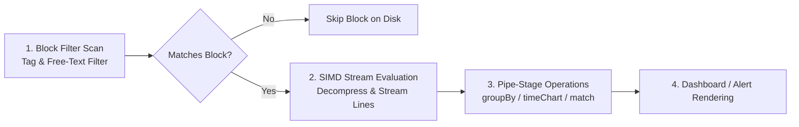

# CrowdStrike Query Language (CQL / LQL) Patterns & References

This domain contains comprehensive language specifications, translation dictionaries, advanced query idioms, and domain-specific detection patterns for CrowdStrike Falcon LogScale.

---

## Architecture of CQL Query Evaluation

LogScale is built as a pure streaming engine. Unlike traditional index-lookup SIEMs that create inverted index trees for every string token, LogScale combines lightweight block filtering with streaming SIMD data processing:

---

## Directory Navigation

- **[`references/`](./references/)**: Core language documentation, command references, and translation frameworks.
  - [`cql-function-reference.md`](./references/cql-function-reference.md): 40+ CQL functions with signatures, examples, and documentation links.
  - [`cql-technique-reference.md`](./references/cql-technique-reference.md): High-speed filtering, sliding windows, multi-repo identity sessionization, and CIDR subnet math.
  - [`legacy-to-cql-rosetta-stone.md`](./references/legacy-to-cql-rosetta-stone.md): 28+ Splunk SPL and Elasticsearch DSL commands translated directly into LogScale CQL.
  - [`sigma-to-cql-conversion-guide.md`](./references/sigma-to-cql-conversion-guide.md): Framework for translating Sigma detection rules into real-time filter alerts and aggregate monitors.
- **[`patterns/`](./patterns/)**: Curated catalog of production-ready CQL queries organized by data domain (AWS CloudTrail, VPC Flow, Okta Identity, GitHub Audit, Endpoint EDR, Generative AI, Windows Event Logs).

---

## The Golden Rules of High-Performance CQL

1. **Filter Before the First Pipe (`|`)**: Every condition placed before the pipe reduces the volume of events processed by memory-intensive transformations.
2. **Beware the Splunk Inversion**: Remember that Splunk `head` returns the newest events, whereas LogScale CQL `tail()` returns the newest events.
3. **Avoid Leading Wildcards**: Avoid `*value*` where an anchored regex `/^value/` or exact equality `field = "value"` is feasible.
4. **Use `select()` Projections**: Use `select([col1, col2])` early in complex pipelines to discard unused fields from RAM.
