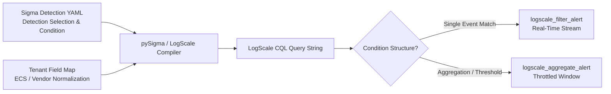

# Sigma Rule to LogScale CQL Conversion Guide

Comprehensive methodology for translating generic Sigma detection-as-code rules into performant CrowdStrike Query Language (CQL) queries and LogScale alerts.

---

## Architecture: Detection-as-Code with Sigma and LogScale



---

## 1. Sigma Detection Condition Semantics

A standard Sigma rule defines criteria in a `detection:` block:

```yaml
detection:
  selection_login:
    Vendor.eventName: 'ConsoleLogin'
    Vendor.userIdentity.type: 'Root'
  filter_known_cidr:
    Vendor.sourceIPAddress|cidr: '192.0.2.0/24'
  condition: selection_login and not filter_known_cidr
```

### Translating Selection Modifiers to CQL

| Sigma Modifier | Example YAML | LogScale CQL Equivalent |
| :--- | :--- | :--- |
| **Exact match** | `field: 'value'` | `field = "value"` |
| **List (OR match)** | `field: ['val1', 'val2']` | `in(field, values=["val1", "val2"])` |
| **Contains** | `CommandLine\|contains: 'mimikatz'` | `CommandLine = "*mimikatz*"` or `/mimikatz/i` |
| **Starts with** | `ImagePath\|startswith: 'C:\Windows\Temp\'` | `ImagePath = /^C:\\Windows\\Temp\\/i` |
| **Ends with** | `FileName\|endswith: '.ps1'` | `FileName = /\.ps1$/i` |
| **Regular Expression** | `CommandLine\|re: 'cmd\.exe\s+/c'` | `CommandLine = /cmd\.exe\s+\/c/i` |
| **CIDR Subnet** | `sourceIP\|cidr: '10.0.0.0/8'` | `cidr(field=sourceIP, subnet="10.0.0.0/8")` |
| **All of selection** | `condition: all of selection_*` | `(sel_1 AND sel_2 AND ...)` |
| **1 of selection** | `condition: 1 of selection_*` | `(sel_1 OR sel_2 OR ...)` |

---

## 2. Choosing the Right LogScale Alert Primitive

When deploying converted Sigma rules via Terraform (`terraform-provider-logscale`), match the rule's operational structure to the appropriate alert type:

### A. Real-Time Filter Alerts (`logscale_filter_alert`)
- **Use Case**: Immediate single-event detections (e.g. AWS root account login, GitHub repository switched to public, unauthorized IAM policy deletion).
- **Behavior**: Evaluates every event at ingest time. Zero latency; fires a webhook immediately upon match.

### B. Aggregate Alerts (`logscale_aggregate_alert`)
- **Use Case**: Threshold and rate-based detections (e.g. 10 failed login attempts in 5 minutes, port scan with >50 rejected connections).
- **Behavior**: Runs a query with `groupBy()` or `count()` across a sliding window (e.g. 5 minutes) and evaluates whether `_count >= threshold`.

---

## 3. Worked End-to-End Example

### Step 1: Input Sigma Rule

```yaml
title: AWS Root Account Console Login
id: a1b2c3d4-0000-4000-8000-000000000001
status: production
logsource:
  product: aws
  service: cloudtrail
detection:
  selection:
    Vendor.eventName: 'ConsoleLogin'
    Vendor.userIdentity.type: 'Root'
    #event.outcome: 'success'
  condition: selection
```

### Step 2: Converted LogScale CQL

```cql
#repo = "aws-cloudtrail-logs"
Vendor.eventName = "ConsoleLogin"
Vendor.userIdentity.type = "Root"
#event.outcome = "success"
| select([@timestamp, Vendor.userIdentity.principalId, Vendor.sourceIPAddress, Vendor.userAgent])
```

### Step 3: Terraform Alert Manifest

```hcl
resource "logscale_filter_alert" "aws_root_login" {
  repository_name = "aws-cloudtrail-logs"
  name            = "AWS Root Account Console Login"
  description     = "Alerts immediately when AWS Root credentials are used to sign into the console."
  query_string    = "#repo = \"aws-cloudtrail-logs\" Vendor.eventName = \"ConsoleLogin\" Vendor.userIdentity.type = \"Root\" #event.outcome = \"success\""
  enabled         = true
  action_ids      = [logscale_action.security_slack.id]
}
```
