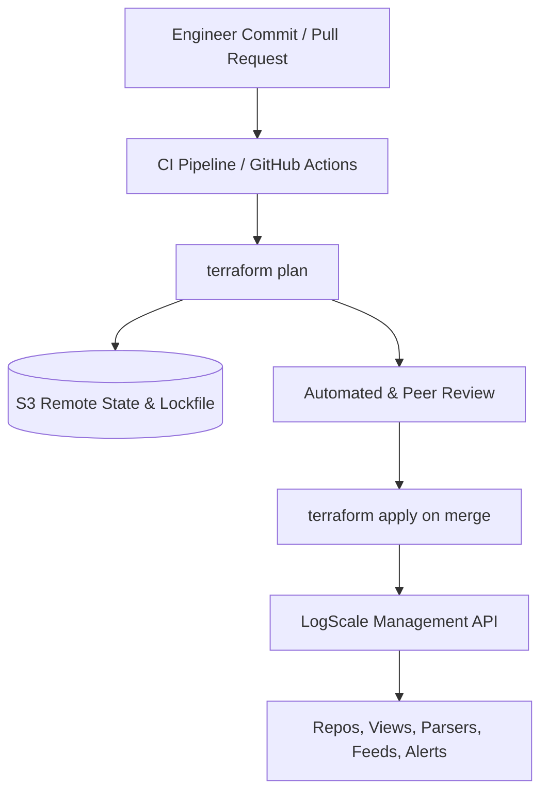

# LogScale Management via Terraform (GitOps)

Infrastructure as Code (IaC) framework for managing CrowdStrike Falcon LogScale resources declaratively using the [Terraform Provider for LogScale](https://github.com/koality-assured/terraform-provider-logscale).

---

## Architecture: LogScale GitOps Pipeline



---

## Directory Organization

```
05-terraform-logscale-management/
├── modules/              # Reusable building blocks
│   ├── repository/       # logscale_repository & logscale_view
│   ├── parser/           # logscale_parser with external script loading
│   ├── ingest-feed/      # logscale_aws_s3_sqs_ingest_feed
│   └── alert/            # logscale_filter_alert & logscale_action
└── environments/         # Complete runnable production blueprint
```

---

## State Management & Best Practices

1. **Remote S3 State**: Store Terraform state in a dedicated S3 bucket with default KMS encryption and `use_lockfile = true` for zero-DynamoDB locking.
2. **Deterministic Locking**: Always commit `.terraform.lock.hcl` to ensure deterministic provider binary verification across engineering teams and CI runners.
3. **Sensitive Token Handling**: Never commit `logscale_api_token`. Supply it via environment variable (`TF_VAR_logscale_api_token`) or a secure secret store.
