# Detection-as-Code Framework for LogScale

This domain outlines an end-to-end Detection-as-Code (DaC) engineering lifecycle: maintaining detection logic in vendor-neutral [Sigma](https://github.com/SigmaHQ/sigma) specification format, compiling rules into CrowdStrike Falcon LogScale CQL queries, and managing deployed alerts via Terraform.

---

## The Detection-as-Code Lifecycle

```mermaid
flowchart LR
    Dev[Detection Engineer] -->|1. Author / Update| Sigma[Sigma Rule YAML<br/>rules/]
    Sigma -->|2. Pull Request| CI[CI Validation Pipeline]
    CI -->|3. Compile to CQL & HCL| Compiler[sigma_to_logscale.py]
    Compiler -->|4. Emit Terraform Alerts| TF[Terraform Alert Manifests]
    TF -->|5. Merge to Main| Apply[terraform apply]
    Apply --> LogScale[LogScale Alert Engine]
```



---

## Directory Organization

```
06-detection-as-code-framework/
├── rules/               # Canonical Sigma YAML detection rules
│   ├── aws-cloudtrail-root-login.yaml
│   ├── okta-mfa-fatigue-attack.yaml
│   └── github-repo-made-public.yaml
└── compiler/            # CLI tool compiling Sigma rules into LogScale alerts
    └── sigma_to_logscale.py
```

---

## Core Advantages

1. **Vendor-Neutral Source of Truth**: Security detections remain in open-source Sigma format rather than proprietary platform languages.
2. **Version Control & Auditability**: Every detection change, threshold adjustment, and tune undergoes peer review in Git.
3. **Automated Alert Lifecycle**: CI/CD pipelines compile Sigma rules into Terraform alert definitions, deploying or retiring monitors without clicking through web consoles.
