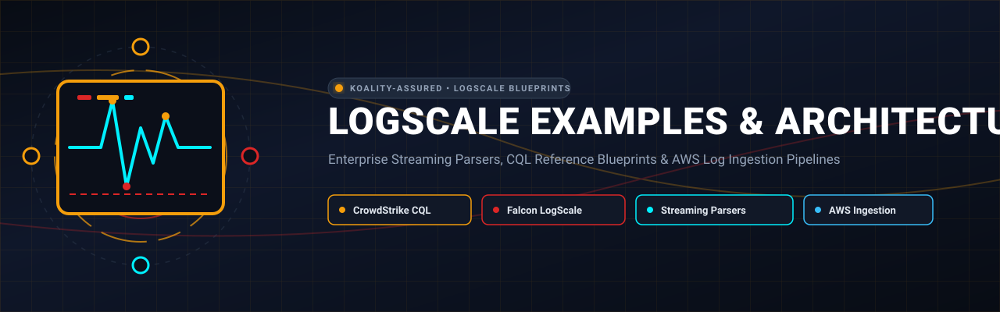
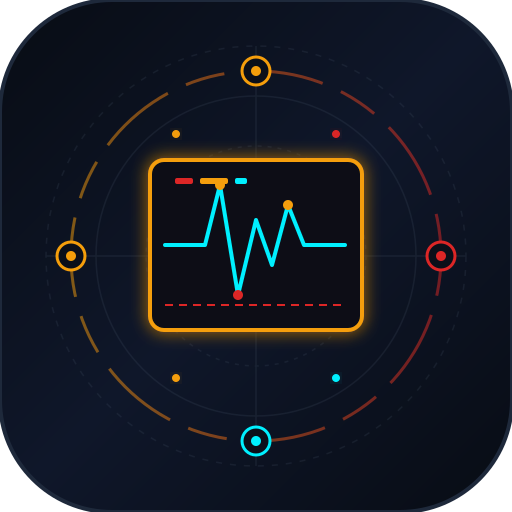
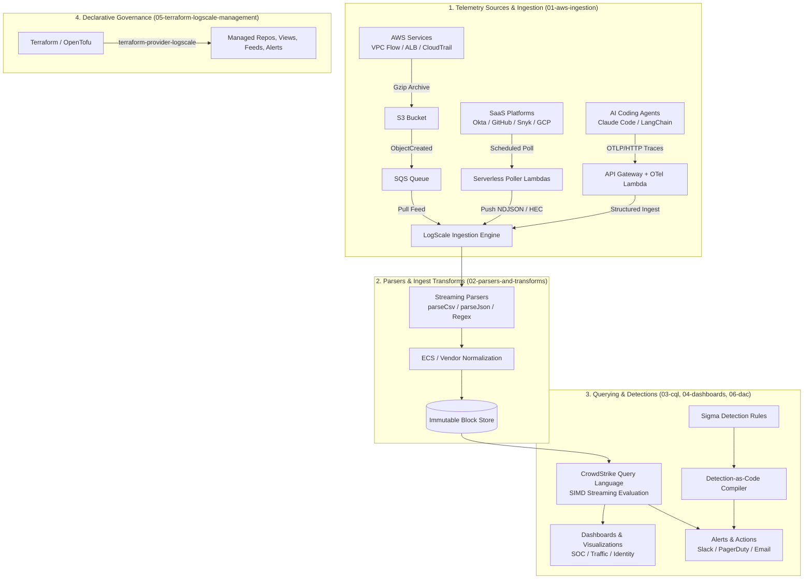

<div align="center">



# LogScale Examples & Architecture

<p align="center">
  
</p>

**Enterprise Streaming Parsers, CQL Reference Blueprints & AWS Log Ingestion Pipelines**

[](https://github.com/Koality-Assured/logscale-examples/actions/workflows/ci.yml)
[](LICENSE)
[]()
[](https://conventionalcommits.org)

</div>

---

Production-grade, generalized, secure architectural patterns, parser definitions, CrowdStrike Query Language (CQL / LQL) references, dashboard blueprints, AWS ingestion pipelines, and Terraform configurations for [CrowdStrike Falcon LogScale](https://www.crowdstrike.com/products/next-gen-siem/falcon-logscale/) (formerly Humio).
This repository serves as an authoritative open-source reference for enterprise security engineering, detection engineering, and observability teams designing resilient cloud log ingestion, high-speed streaming parsers, detection-as-code pipelines, and operational dashboards.
> [!NOTE]
> **Advisory & Reference Only**: All examples are generalized, sanitized, and synthetic. No real cloud infrastructure is mutated from this repository, and no live credentials are committed. Use these architectures and configurations as blueprints for production stacks.

---

## Architecture at a Glance

---
## Repository Map & Navigation
The repository is partitioned into six functional domains:
```
logscale-examples/
├── 01-aws-ingestion/                    # Enterprise ingestion architectures in AWS
│   ├── s3-sqs-pull-feed/               # AWS S3 -> SQS -> LogScale Ingest Feed (VPC Flow, CloudTrail, ALB)
│   ├── serverless-api-poller/          # EventBridge + Lambda scheduled SaaS log pullers (Okta, GitHub, Snyk, GCP)
│   └── telemetry-otel-collector/       # OpenTelemetry / GenAI agent trace & log forwarder into LogScale
│
├── 02-parsers-and-transforms/           # LogScale parser configurations (v0.3.0 schema) with unit test cases
│   ├── aws-alb-access/                 # Space-delimited AWS Application Load Balancer access log parser
│   ├── aws-vpc-flow/                   # Positional/CSV VPC Flow log parser with flag decoding
│   ├── aws-cloudtrail/                 # AWS CloudTrail JSON parser with ECS field normalization
│   ├── okta-system-log/                # Okta event parser normalizing actor, target, client geo
│   ├── github-audit/                   # GitHub Enterprise audit event parser
│   ├── snyk-vulnerabilities/           # Snyk vulnerability finding and audit parser
│   └── generic-json/                   # High-performance generic JSON parser with tag routing
│
├── 03-cql-patterns-and-queries/         # CrowdStrike Query Language (CQL / LQL) reference & pattern catalog
│   ├── references/                     # Comprehensive language documentation
│   │   ├── cql-function-reference.md   # 40+ CQL functions (groupBy, timeChart, bucket, regex, selfJoinFilter)
│   │   ├── cql-technique-reference.md  # Advanced techniques: sliding windows, sessionization, CIDR matching
│   │   ├── legacy-to-cql-rosetta-stone.md # Splunk SPL & Elasticsearch DSL -> CQL translation map (28+ commands)
│   │   └── sigma-to-cql-conversion-guide.md # Converting Sigma detection-as-code rules into performant CQL
│   └── patterns/                       # Domain query catalogs (Markdown + query patterns JSON)
│       ├── aws-cloudtrail/             # Root account usage, IAM escalation, security group broad exposure
│       ├── aws-vpc-flow/               # Rejected connections, port scanning, abnormal egress transfer
│       ├── okta-identity/              # Brute-force attacks, MFA fatigue/resets, geo-distance anomaly logins
│       ├── github-audit/               # Public repo exposure, admin role elevation, deploy key additions
│       ├── endpoint-edr/               # Process injection, suspicious parent-child chains, LOLBins execution
│       ├── generative-ai/              # LLM token usage spikes, prompt latency percentiles, error rates
│       └── windows-security/           # Event IDs 4624 (logons), 4688 (process creation), Sysmon telemetry
│
├── 04-dashboards-and-alerts/            # Production LogScale dashboards (v0.23.0) and alert configurations
│   ├── dashboards/                     # Declarative YAML dashboards ready for GitOps import
│   │   ├── security-operations-center.yaml # Unified SOC 24h operational overview (KPIs, maps, sankeys, tables)
│   │   ├── aws-traffic-and-infrastructure.yaml # VPC flow and ALB performance metrics
│   │   └── identity-governance.yaml    # Okta authentication health and administrative action tracking
│   └── alerts-and-triggers/            # Action and scheduled search definitions (v0.10.0 and v0.3.0 schemas)
│       ├── actions/                    # Webhook, Slack, PagerDuty, and CSV lookup upload actions
│       └── triggers/                   # Scheduled searches, filter alerts, and aggregate threshold monitors
│
├── 05-terraform-logscale-management/    # LogScale configuration as code via terraform-provider-logscale
│   ├── modules/                        # Reusable Terraform modules (repository, parser, ingest-feed, alert)
│   └── environments/                   # Production environment deployment blueprint
│
├── 06-detection-as-code-framework/      # Modern Detection-as-Code pipeline architecture
│   ├── rules/                          # Canonical Sigma YAML detection rules
│   └── compiler/                       # Lightweight Python compiler transforming Sigma YAML -> LogScale alerts
│
├── adversarial_review.py                # Zero-leak cryptographic hash auditor & syntax validator
├── AGENTS.md                            # Operational agent directives for this repository
├── LICENSE                              # MIT License (Koality Assured)
└── README.md                            # Root documentation and navigation index
```
---
## Domain Highlights
### 1. AWS Ingestion Pipelines (`01-aws-ingestion/`)
- **[S3-to-SQS Pull Feeds](./01-aws-ingestion/s3-sqs-pull-feed/)**: Complete IaC (Pulumi and Terraform) for decoupling log production from LogScale ingestion. SQS buffers notifications for up to 14 days, providing zero-data-loss durability. Includes cross-account IAM trust policies with `sts:ExternalId` validation.
- **[Serverless API Pollers](./01-aws-ingestion/serverless-api-poller/)**: Production serverless Python Lambdas ingesting from GitHub Enterprise, Okta, Snyk, and GCP Cloud Audit. Features HTTP ETag conditional requests (`304 Not Modified`) to eliminate rate-limit burn on idle cycles.
- **[OpenTelemetry Collector](./01-aws-ingestion/telemetry-otel-collector/)**: Serverless collector translating OTLP/HTTP traces and logs from GenAI coding agents (e.g. Claude Code) into LogScale structured events.
### 2. Parsers & Ingest Transforms (`02-parsers-and-transforms/`)
- Written in official LogScale parser schema `v0.3.0`.
- Includes parsers for **AWS ALB Access Logs**, **AWS VPC Flow Logs**, **AWS CloudTrail**, **Okta System Logs**, **GitHub Audit Logs**, and **Snyk Vulnerabilities**.
- **The Tag Cardinality Rule**: Comprehensive guidance on why tagging high-cardinality fields (like IPs or user IDs) degrades cluster performance, with instructions on using bounded tags (`#action`, `#service`, `#level`).
### 3. CrowdStrike Query Language (CQL) Reference & Patterns (`03-cql-patterns-and-queries/`)
- **[CQL Function Reference](./03-cql-patterns-and-queries/references/cql-function-reference.md)**: Syntax, usage patterns, and gotchas for 40+ functions (`groupBy`, `count`, `top`, `timeChart`, `bucket`, `selfJoinFilter`, `formatTime`, `cidr`).
- **[Legacy SPL to CQL Rosetta Stone](./03-cql-patterns-and-queries/references/legacy-to-cql-rosetta-stone.md)**: Side-by-side translation table mapping 28+ Splunk and Elasticsearch commands into CQL. Explains critical inversions (e.g. Splunk `head` vs LogScale `tail`).
- **Domain Pattern Catalog**: Pre-built detection queries across CloudTrail, VPC Flow, Okta, GitHub, Endpoint EDR, GenAI LLM metrics, and Windows Event Logs.
### 4. Dashboards & Alerts (`04-dashboards-and-alerts/`)
- Declarative dashboards in Humio schema `v0.23.0` ready for GitOps import or UI upload.
- Modular alerting architecture separating **actions** (`v0.10.0` schema: Slack webhooks, PagerDuty, CSV lookup uploads) from **triggers** (`v0.3.0` schema: scheduled CQL cron searches).
- Deep operational notes covering 12-column grid geometry, XML-safe HTML in note widgets, and avoiding parameter existence filter footguns.
### 5. Terraform LogScale Management (`05-terraform-logscale-management/`)
- Complete Infrastructure as Code using [`terraform-provider-logscale`](https://github.com/koality-assured/terraform-provider-logscale).
- Reusable modules for repositories, views, parsers, S3-SQS ingest feeds, and real-time alerts.
- Production environment blueprint demonstrating remote S3 state with native lockfile locking.
### 6. Detection-as-Code Framework (`06-detection-as-code-framework/`)
- Canonical Sigma YAML detection rules serving as the single source of truth.
- Lightweight Python CLI compiler ([`sigma_to_logscale.py`](./06-detection-as-code-framework/compiler/sigma_to_logscale.py)) that translates Sigma criteria into LogScale CQL and generates Terraform alert resources.
---
## Adversarial Quality & Security Audit
This repository enforces strict sanitization and hygiene standards to guarantee **zero leaks** of private credentials, internal identifiers, employee names, or realistic account numbers.
To execute the adversarial audit locally:
```bash
python adversarial_review.py
```
The auditor executes four automated verification phases:
1. **Zero-Leak Cryptographic Hash Scan**: Hashes every token and word across every file against SHA-256 digests of private identifiers.
2. **Pattern Leak Scan**: Verifies zero local developer file paths, local user profile paths, or secret tokens.
3. **Syntax Verification**: Parses 100% of YAML, Python, and JSON files using native compilers.
4. **Execution Policy Enforcement**: Confirms no real running GitHub Actions workflows exist.
5. **Documentation Coverage**: Verifies every example directory maintains an informative README.
---
## License
This project is licensed under the [MIT License](./LICENSE). Copyright (c) 2026 Koality Assured.
